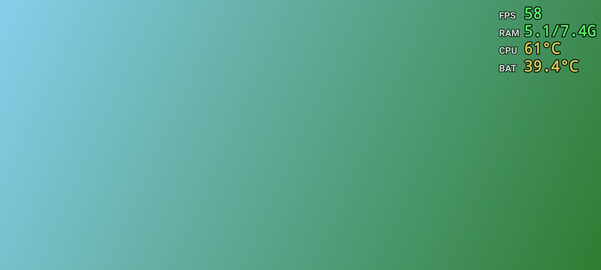

# PerfOverlay

**FPS / RAM使用量 / 温度** を画面の右上に大きく、ずっと表示し続ける Android アプリです。

- Android 5.0（API 21）以上
- **root 不要**
- ほかのアプリ（ゲームなど）の上に重ねて表示し、タッチの邪魔をしない
- 常駐通知から停止できる。端末の起動時に自動で開始することもできる



背景は付けず、文字に黒フチを付けてどんな画面でも読めるようにしています。色は 緑=良好 / 黄=注意 / 赤=重い・熱い。CPU 温度は読める機種のみ表示されます。

## インストール

1. APK を入手する（どちらか）
   - GitHub の **Releases** から `PerfOverlay.apk` をダウンロード
   - **Actions** の最新ビルドの Artifacts から `PerfOverlay-apk` をダウンロード（zip を展開）
2. スマホで APK を開き、「提供元不明のアプリ」のインストールを許可してインストール

## 使い方

1. アプリを開き、「他のアプリの上に重ねて表示を許可」を押して許可する
2. Android 13 以上なら「通知を許可」も押す（常駐通知用。なくても動作はします）
3. 開始ボタンを押す
   - **▶ 開始（FPS計測あり・おすすめ）**: 画面の録画/共有の確認が出るので「画面全体」を選んで許可。ゲームの実際の FPS が表示されます
   - **▶ 開始（画面キャプチャなし）**: 確認なしで開始。FPS の代わりに画面のリフレッシュレート（Hz）を表示します
4. あとはゲームなどを起動するだけ。止めるときは通知の「停止」かアプリの「■ 停止」

文字サイズ（既定 20sp、12〜60sp）・右端/上端からの距離はアプリ内のスライダーで変更でき、表示中でもすぐ反映されます。

## 各項目の測り方

| 表示 | 内容 | 方法（root 不要） |
|---|---|---|
| FPS | 1秒間に画面が更新された回数 | 画面を 1/8 に縮小した仮想ディスプレイ（MediaProjection）を作り、届いたフレーム数を数える。Android は画面の内容が変わったときだけフレームを送るので、これが前面アプリの実際の FPS になる。受け取った画像はすぐ破棄し、保存も送信もしない |
| Hz | 画面のリフレッシュレート | キャプチャなしモード用。`Display.getRefreshRate()` を 1 秒に 1 回読むだけなので負荷はほぼゼロ |
| RAM | 端末全体の使用量 / 総容量 | `ActivityManager.getMemoryInfo()` |
| CPU | CPU 系センサーの最高温度 | `/sys/class/thermal/thermal_zone*/temp` など。Android 8 以降の多くの機種は SELinux で読めないので、その場合は行ごと非表示 |
| BAT | バッテリー温度 | `ACTION_BATTERY_CHANGED`（全機種で取得可能） |

### 注意点

- 非 root では、他アプリの FPS を直接取得する API がありません。正確な FPS が必要なときは「FPS計測あり」モードを使ってください。
- 画面が止まっていると FPS は 0〜1 になります（更新がないため。正常です）。
- Android 14 以降は、ステータスバーの「共有中」チップなどから画面キャプチャを止めると自動的にキャプチャなしモード（Hz 表示）に切り替わります。端末を再起動したときの自動開始もキャプチャなしモードです（画面キャプチャは毎回ユーザーの許可が必要なため）。
- Android 12 以降はオーバーレイが不透明だとその部分のタッチが下のアプリに届かないため、表示全体を 80% の不透明度にしています。
- Xiaomi（MIUI / HyperOS）などで表示されない場合は、アプリ情報の「その他の権限」で「バックグラウンドでポップアップを表示」も許可してください。勝手に止まる場合は電池の最適化をこのアプリだけ「制限なし」にしてください。

## ビルド

```sh
./gradlew assembleRelease
# → app/build/outputs/apk/release/app-release.apk
```

JDK 17 と Android SDK（compileSdk 35）が必要です。GitHub に push すると Actions が自動でビルドし、`v*` タグを push すると Releases に APK を添付します。

署名鍵 `signing/perfoverlay.jks`（パスワード `android`）は、どこでビルドしても上書きインストールできるようリポジトリに含めています。Android の debug 鍵と同じ扱いなので、ストアなどで公開配布する場合は自分の鍵に差し替えてください。

## 構成

| ファイル | 役割 |
|---|---|
| `MainActivity.java` | 権限の案内、開始/停止、表示設定 |
| `OverlayService.java` | 常駐（フォアグラウンドサービス）とオーバーレイ表示、1秒ごとの更新 |
| `OverlayView.java` | 右上の表の描画（等幅フォント＋黒フチ） |
| `CaptureFpsMeter.java` | 画面キャプチャによる FPS 計測 |
| `RefreshRateMeter.java` | キャプチャなしモードの Hz 表示 |
| `CpuTempReader.java` | sysfs からの CPU 温度読み取り |
| `BootReceiver.java` | 起動時の自動開始 |
